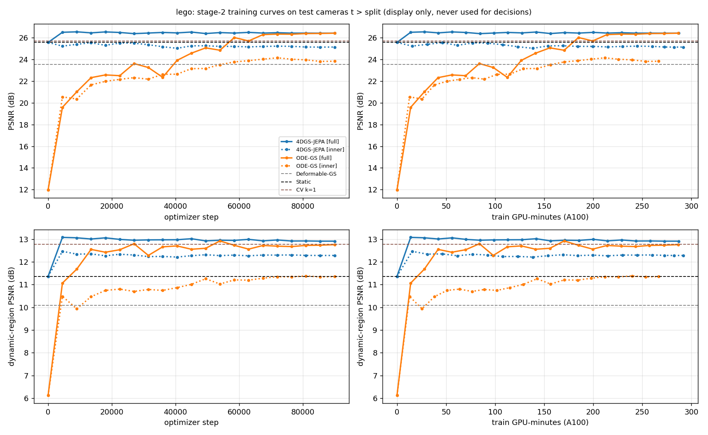
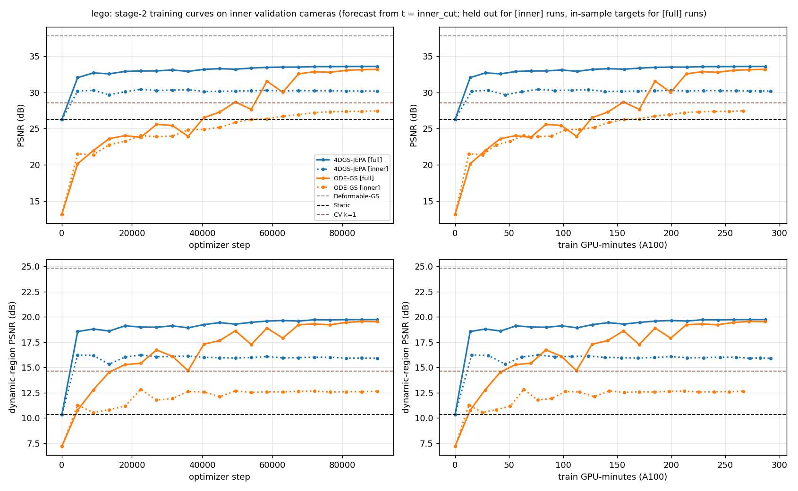
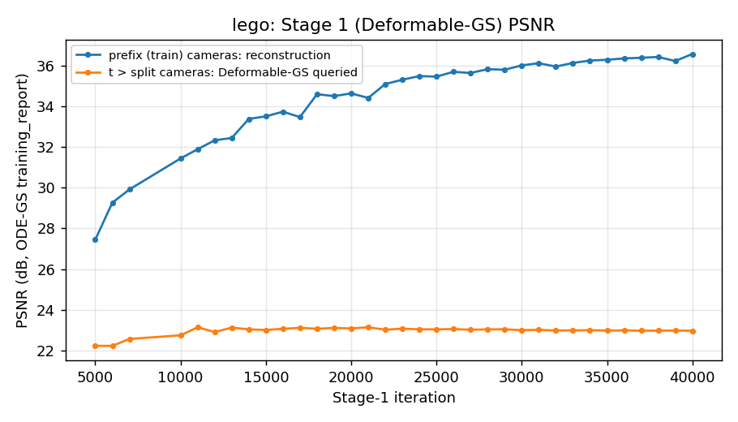
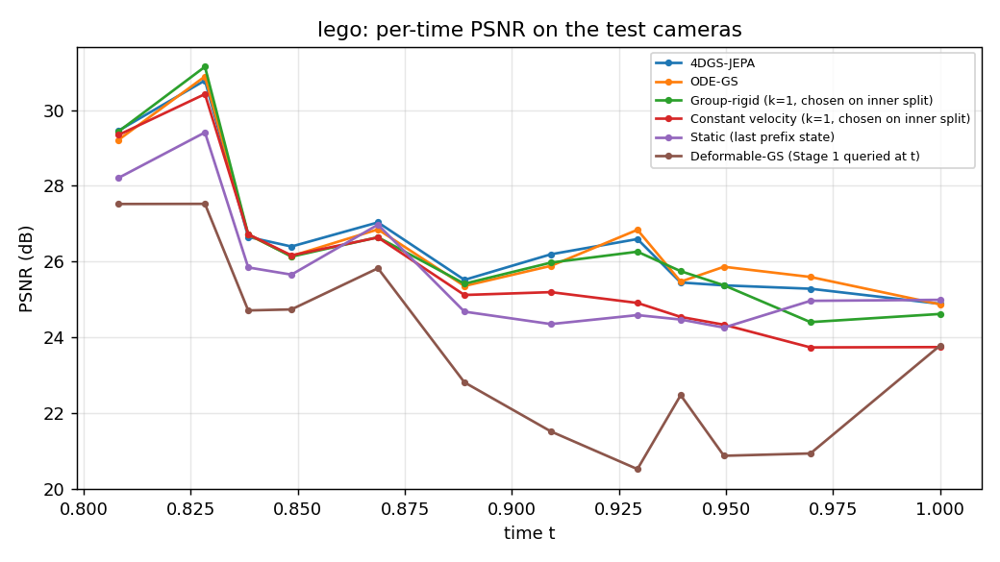

# D-NeRF lego: controlled stage-2 comparison (4DGS-JEPA vs ODE-GS, shared Stage 1)

_Auto-generated by `scripts/fair_report.py --write_report`; numbers are seed 0, last checkpoint._

## Scene and protocol

- Data: `/data/D-NeRF/lego` (Blender format, black background, 800×800). Train + test cameras are pooled, as in ODE-GS protocol B.
- Protocol B with time_split 0.8: cameras are sorted by time and the first 80% form the prefix. Prefix: 56 cameras / 46 times, last t = 0.7879. Test: 14 cameras, t ≥ 0.8081. Image size [800, 800] (H, W). Frame spacing dt = 0.020202.
- Shared Stage 1: Deformable-GS trained by ODE-GS `train_interpolation.py --time_split 0.8 --is_blender` with ODE-GS defaults (40k iterations, as in the paper), 129596 Gaussians. Final Stage-1 PSNR: prefix (train) cameras 36.57, t > 0.8 cameras queried 22.97.
  Every method below starts from it: Deformable-GS query, static, constant velocity, ODE-GS and JEPA.
- Inner split, used for the held-out validation curves, the CV window: stage 2 sees Stage-1 states with t ≤ 0.64 only and is scored on the prefix cameras with 0.64 < t ≤ prefix end. Test-camera numbers never drive a decision.
- Controlled stage 2. These are identical for JEPA and ODE-GS: optimizer steps (90k), Gaussian samples per step (4096), observation points (the same 30 Stage-1 time points, span ≈ 0.586), training horizon (≈ 0.202), AdamW with LR 1e-3, weight decay 1e-4, 5% warmup then cosine to 0.01×, grad clip 1.0, seed 0, and the last checkpoint. Parameter counts differ by 5% (JEPA 4.08M vs ODE-GS 3.88M). Settings are the HyperNeRF ones unchanged, except that the training horizon is the D-NeRF test range (0.2, ODE-GS's own D-NeRF max_extrap_time_span) instead of 0.1.
- Inherent differences (method design, not tuned): JEPA's loss is latent prediction (EMA teacher) + composition + geometry decoding with 4 targets per context. ODE-GS uses an L1 trajectory loss on 10 targets plus its adaptive derivative regulariser (D-NeRF config: reg_weight 1e-05, temperature 0.05, xyz_reg 0.001).
- Dynamic-region metrics: the mask is computed once per scene, identically for all methods. It keeps pixels where max_c |GT_t − R_t0| > 0.2, with R_t0 the Stage-1 render of the static state at the forecast origin from the same camera, then applies opening (radius 2) and dilation (4 px). It marks where the scene changed, so it penalises Static by construction. dyn PSNR = PSNR over mask pixels; dyn SSIM / LPIPS = SSIM map / spatial LPIPS-vgg averaged over the mask. Cameras whose mask is empty (no change yet) are left out of the dynamic-region averages.

## Stage-2 configuration (every variable)

| run | method | split | params | optimizer steps | Gaussian samples/step | observation window | train horizon | optimizer | LR peak | schedule | weight decay | grad clip | seed | train GPU-min (A100) |
|---|---|---|---|---|---|---|---|---|---|---|---|---|---|---|
| jepa_full | jepa | full | 4.08M | 90000 | 4 ctx × 1024 = 4096 | 30 Stage-1 frames, stride 1 (span 0.5859) | ≤ 10 frames (= 0.2020 time) | AdamW | 0.001 | warmup 5% + cosine → 0.01× | 0.0001 | 1.0 | 0 | 287.1 |
| jepa_inner | jepa | inner | 4.08M | 90000 | 4 ctx × 1024 = 4096 | 30 Stage-1 frames, stride 1 (span 0.5859) | ≤ 10 frames (= 0.2020 time) | AdamW | 0.001 | warmup 5% + cosine → 0.01× | 0.0001 | 1.0 | 0 | 291.9 |
| odegs_full | odegs | full | 3.88M | 90000 | 4096 | 0.5859 time span, 30 points | ≤ 0.2020 time (10 pts) | AdamW | 0.001 | warmup 5% + cosine → 0.01× | 0.0001 | 1.0 | 0 | 286.4 |
| odegs_inner | odegs | inner | 3.88M | 90000 | 4096 | 0.5859 time span, 30 points | ≤ 0.2020 time (10 pts) | AdamW | 0.001 | warmup 5% + cosine → 0.01× | 0.0001 | 1.0 | 0 | 266.4 |

## Test: protocol-B evaluation cameras (t > split), forecast from the end of the prefix

| method | PSNR | PSNR_img | SSIM | LPIPS | dyn PSNR | dyn SSIM | dyn LPIPS |
|---|---|---|---|---|---|---|---|
| **4DGS-JEPA** | 26.43 | 26.04 | 0.9376 | 0.0541 | 12.91 | 0.2725 | 0.5260 |
| **ODE-GS** | 26.42 | 26.06 | 0.9393 | 0.0517 | 12.76 | 0.2660 | 0.5215 |
| Group-rigid (k=1, chosen on inner split) | 26.28 | 25.96 | 0.9316 | 0.0520 | 13.20 | 0.2939 | 0.4979 |
| Constant velocity (k=1, chosen on inner split) | 25.69 | 25.35 | 0.9247 | 0.0706 | 12.77 | 0.2580 | 0.5396 |
| Static (last prefix state) | 25.57 | 25.16 | 0.9386 | 0.0529 | 11.36 | 0.1879 | 0.5747 |
| Deformable-GS (Stage 1 queried at t) | 23.56 | 22.97 | 0.9329 | 0.0606 | 10.09 | 0.1815 | 0.6391 |
| _CV, all k (display only): k=1: 25.69, k=2: 25.49, k=4: 25.09, k=8: 25.43, k=16: 25.14_ | | | | | | | |

## Inner validation: prefix cameras inner_cut < t ≤ prefix end, forecast from inner_cut

| method | PSNR | PSNR_img | SSIM | LPIPS | dyn PSNR | dyn SSIM | dyn LPIPS |
|---|---|---|---|---|---|---|---|
| **4DGS-JEPA** | 30.17 | 29.72 | 0.9652 | 0.0326 | 15.90 | 0.4597 | 0.3726 |
| **ODE-GS** | 27.46 | 27.07 | 0.9493 | 0.0423 | 12.64 | 0.3055 | 0.4854 |
| Group-rigid (k=1, chosen on inner split) | 28.28 | 27.86 | 0.9506 | 0.0374 | 14.59 | 0.4160 | 0.3910 |
| Constant velocity (k=1, chosen on inner split) | 28.54 | 27.93 | 0.9524 | 0.0525 | 14.66 | 0.4221 | 0.4264 |
| Static (last prefix state) | 26.26 | 25.74 | 0.9583 | 0.0389 | 10.32 | 0.1587 | 0.5932 |
| _Stage-1 fit at these times (in-sample for Stage 1, NOT a forecast)_ | 37.76 | 37.38 | 0.9897 | 0.0164 | 24.84 | 0.8876 | 0.1381 |

## Training PSNR curves

Each learned run is scored at every 5% of its step budget. The x-axis is the optimizer step on the left and the training GPU-minutes on the right, with evaluation time excluded. Dashed lines show Deformable-GS, Static and CV. Raw data: `curves.csv`; Stage 1: `stage1_curve.csv`.

Test cameras (display only):

Inner validation cameras. Dotted lines are the [inner] runs, where these cameras are held out. Solid lines are the [full] runs, where they are in-sample targets.

Stage 1 (Deformable-GS):

Per-time PSNR on the test cameras:

## Dynamic-region masks (examples, red overlay)

## Videos

- `../videos/lego_eval.mp4`: every test camera at its own pose and time; GT / Deform-GS / Static / CV / ODE-GS / JEPA, with per-frame PSNR.
- `../videos/lego_sweep.mp4`: one fixed test camera with t swept over [0, 1]. Inside the prefix every method shows Stage 1; after it, each method shows its forecast.

## Quick reading (auto)

- Best full-image PSNR on the test cameras among the learned stage-2 runs: **jepa_full** (26.43).
- jepa_full: +0.85 dB vs Static, +2.87 dB vs Deformable-GS query; dynamic region +1.55 dB vs Static.
- odegs_full: +0.85 dB vs Static, +2.86 dB vs Deformable-GS query; dynamic region +1.40 dB vs Static.
